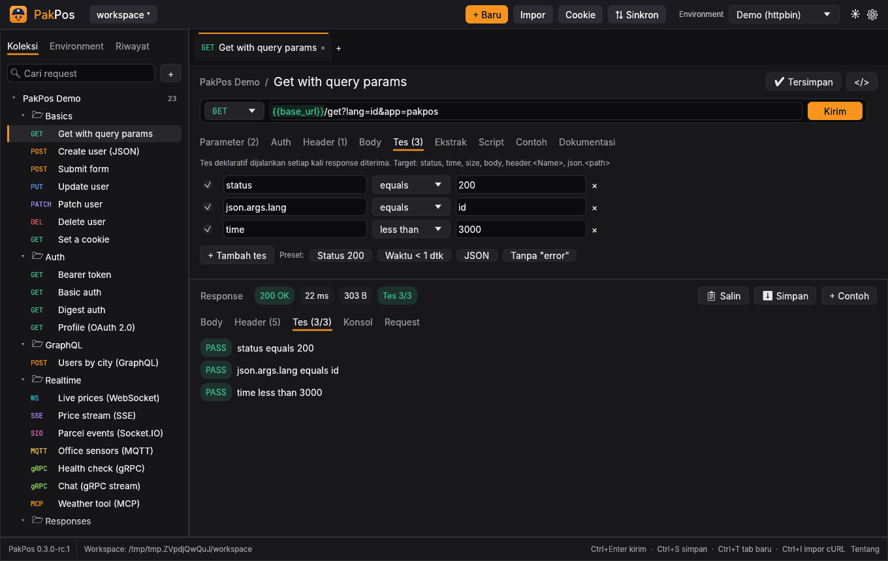

<p align="center">
  
</p>

<h1 align="center">PakPos</h1>

<p align="center">
  API client yang langsung kebuka, datanya tetap di laptop kamu,<br>
  dan nggak minta login. Ditulis pakai Rust.
</p>

<p align="center">
  <a href="README.md">English</a> · <b>Bahasa Indonesia</b> · <a href="https://sansob.github.io/PakPos/">Dokumentasi</a>
</p>


## Kenapa bikin ini?

Kebanyakan dari kita cuma mau kirim request, lihat JSON-nya, ganti satu header,
terus coba lagi. Tapi API client sekarang makin berat: aplikasi Electron yang
minta akun, sync collection ke cloud orang lain, dan butuh beberapa detik cuma
buat kebuka.

PakPos balik ke dasar dan berusaha ngerjain itu dengan baik. Aplikasinya native
(satu binary ~26 MB, tanpa Electron), kebukanya cepat, dan semua yang kamu bikin
disimpan sebagai file JSON biasa di folder pilihan kamu. Bagian terakhir ini
penting: taruh foldernya di repo git project kamu, dan satu tim langsung pakai
collection yang sama, perubahan di-review lewat pull request seperti kode biasa.

Namanya? *Pak Pos*, yang mengantar surat kamu dan bawa balasannya pulang. Ya
cuma itu tugasnya.

## Bisa apa saja sekarang

Kirim request dengan method apa pun, lengkap dengan query params, header, dan
body JSON, form, multipart, file, atau GraphQL. Auth Basic, Bearer, API key,
Digest, NTLM, AWS Signature v4, dan OAuth 2.0 sudah ada (client credentials,
password, dan login lewat browser dengan PKCE), plus sertifikat klien (mTLS)
per host. Request bisa "mewarisi" auth dari folder atau collection, jadi token cukup
diset sekali. Token OAuth diambil dan diperbarui otomatis, dan disimpan di file
lokal, bukan di collection yang kamu bagikan.

Bukan cuma HTTP. Request bisa berupa koneksi **WebSocket**, **Server-Sent
Events**, **Socket.IO**, atau **MQTT** (connect, kirim atau publish, lihat log
langsung) atau panggilan **gRPC**: PakPos membaca service dari server reflection
atau file `.proto` kamu, kasih template JSON untuk pesannya, lalu menampilkan
balasannya. Stream client dan dua arah tetap terbuka, jadi pesan bisa dikirim
satu per satu dan balasannya muncul langsung. GraphQL punya schema explorer,
jadi tinggal klik untuk dapat query awal. Lagi bikin **server MCP**? Request bisa
memanggil tool, membaca resource, dan mengambil prompt-nya, dengan test yang
sama seperti request REST.

Response bisa dicari (`Ctrl/⌘ + F`), dilihat sebagai pohon JSON, dan
dipratinjau kalau isinya gambar atau HTML. Cookie dari server masuk ke cookie
jar yang bisa dilihat dan diedit. Urutan request dan folder bisa diatur dengan
drag & drop.

Request disusun dalam collection dan folder. Environment menyimpan variabel
seperti `{{base_url}}` dan `{{token}}`: ganti dari Staging ke Production di
header, semua request ikut. Variabel yang ketemu warnanya hijau, yang nggak
ketemu merah, jadi typo langsung kelihatan.

Untuk mengecek response ada dua cara. Pengecekan sederhana seperti `status
equals 200` atau `json.data.id exists` sudah cukup untuk kebanyakan kebutuhan
dan gampang di-review. Kalau butuh lebih, tulis JavaScript dengan API `pm.*`
(`pm.test`, `pm.expect`, `pm.environment.set`…). Script jalan di sandbox tanpa
akses file, script dari collection hasil import baru jalan setelah kamu
menyatakan percaya, dan `pm.sendRequest` cuma bisa dipakai di collection yang
juga kamu beri akses jaringan.

Response bisa disimpan sebagai **example**, lalu PakPos bisa menyajikannya sebagai
mock API. Cocok kalau frontend sudah siap duluan sebelum backend.

Punya collection dari tool lain? File berformat Collection v2.1 JSON beserta
environment-nya bisa [langsung diimport](docs/src/tutorial/import.md): folder, auth (termasuk OAuth 2.0), body GraphQL, script, dan example ikut
terbawa. Bisa juga paste perintah `curl` langsung ke kolom URL, atau sebaliknya
pakai tombol `</>` untuk dapat snippet cURL, Python, JavaScript, atau HTTPie.
Spec OpenAPI 3 dan Swagger 2 (JSON atau YAML) juga bisa diimport, dan collection
apa pun bisa diekspor balik ke OpenAPI 3.

Sengaja nggak pakai cloud. Kalau mau berbagi dengan tim, tombol **⇅ Sync** menjadikan
workspace sebuah repo git, lalu commit, pull, dan push memakai git yang sudah
terpasang di komputer kamu. Riwayat dan hak akses tetap di GitHub/GitLab/tempat
kode kamu berada.

Tampilannya tersedia dalam bahasa Inggris dan Bahasa Indonesia (Pengaturan →
Bahasa). Ada mode terang juga:


Dan ini tampilannya dalam Bahasa Indonesia:



## Command line dan CI

Mesin yang sama tersedia sebagai `pakpos-cli`, jadi collection yang kamu klik di
aplikasi bisa jalan juga di pipeline:

```sh
pakpos-cli run api/collection.json -e api/staging.json --var token=$API_TOKEN \
  --reporter junit --out report.xml
```

Exit code-nya bukan nol kalau ada test yang gagal, bisa output JUnit untuk GitHub
Actions/GitLab/Jenkins, dan bisa baca file Collection v2.1 dan OpenAPI juga.
Tambahkan `-d users.csv` untuk menjalankan collection sekali per baris data.
Selain itu ada `pakpos-cli grpc`, `ws`, `sse`, `socketio`, `mqtt`, `mcp-client`,
dan `mock` untuk dipakai langsung dari terminal.

## Dipakai AI agent

`pakpos-cli mcp` menjalankan server [Model Context Protocol](https://modelcontextprotocol.io),
jadi Claude, Cursor, VS Code, dan sejenisnya bisa melihat collection kamu, menjalankan
request yang tersimpan, dan membaca hasilnya. Hati-hati: agent yang bisa kirim
HTTP request bisa menjangkau apa pun yang bisa dijangkau laptop kamu. Jadi jalankan
dengan `--allow-host` dan sebutkan hanya API yang boleh disentuh.

## Cara pasang

Ambil build untuk OS kamu di [halaman releases](https://github.com/sansob/PakPos/releases):
installer atau zip portable untuk Windows (x64 dan ARM64), `.dmg` untuk macOS
(Apple Silicon dan Intel jadi satu), dan `.deb`, `.rpm`, AppImage, atau tarball untuk Linux (x86_64 dan arm64).

Build-nya nggak di-code-sign, jadi OS kamu akan protes saat pertama dibuka. Di
macOS 15 ke atas buka **System Settings → Privacy & Security** lalu klik
**Open Anyway** (versi lama: klik kanan aplikasi → **Open**); di Windows klik
**More info → Run anyway**. Tiap rilis juga menyertakan manifest Homebrew,
winget, AUR, dan Flatpak.

Mau build sendiri? Butuh Rust 1.95 atau lebih baru:

```sh
git clone https://github.com/sansob/PakPos && cd PakPos
cargo run --release -p pakpos
```

Saat pertama dibuka, otomatis ada collection demo supaya kamu bisa langsung
tekan **Send** (`Ctrl/⌘ + Enter`).

## Yang belum bisa

Proyek ini masih muda. Supaya jujur soal kekurangannya: script belum bisa
memuat library npm, runner koleksi melewati request WebSocket, SSE, Socket.IO,
dan MQTT (karena sifatnya interaktif), manifest paketnya belum dipublikasikan
ke Homebrew, winget, Flathub, atau AUR, dan build-nya belum di-sign. Lihat
[roadmap](docs/src/roadmap.md); semuanya boleh diambil kalau mau bantu.

## Mau bantu?

Issue, ide, perbaikan dokumentasi, dan terjemahan sama berharganya dengan kode.
Baca [CONTRIBUTING.md](CONTRIBUTING.md). Intinya: bikin branch dari `develop`,
pastikan `cargo fmt`, `clippy`, dan test lolos, lalu buka PR ke `develop`.

## Lisensi

MIT atau Apache-2.0, pilih yang cocok.

PakPos adalah proyek independen dan tidak berafiliasi dengan Postman, Inc.
Lihat [kebijakan code signing](docs/src/code-signing-policy.md) (termasuk kebijakan privasi).
