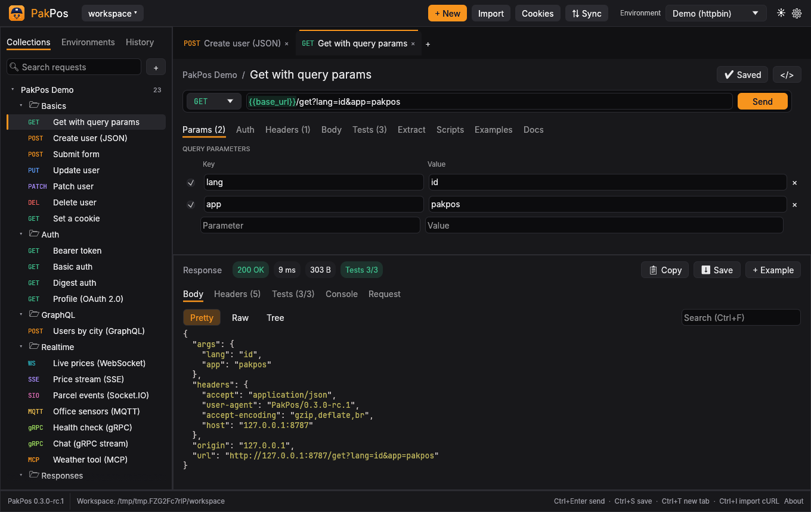
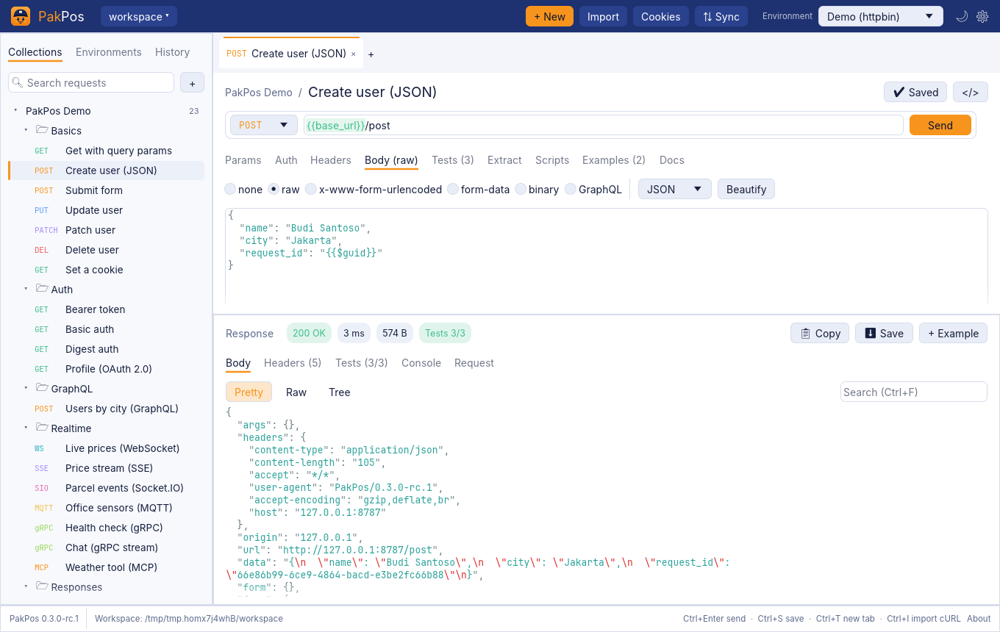

<p align="center">
  
</p>

<h1 align="center">PakPos</h1>

<p align="center">
  An API client that opens instantly, keeps your data on your machine,<br>
  and doesn't ask you to sign in. Written in Rust.
</p>

<p align="center">
  <a href="https://github.com/sansob/PakPos/actions/workflows/ci.yml"></a>
  <a href="https://github.com/sansob/PakPos/releases"></a>
  
</p>

<p align="center">
  <b>English</b> · <a href="README.id.md">Bahasa Indonesia</a> · <a href="https://sansob.github.io/PakPos/">Docs</a>
</p>



## Why this exists

Most of us just want to fire off a request, look at the JSON, tweak a header and
try again. Somewhere along the way API clients turned into heavy Electron apps
that want an account, sync your collections to someone else's cloud and take a
few seconds to start.

PakPos goes back to the basics and tries to do them well. It's a native app
(a single ~26 MB binary, no Electron), it starts before you can blink, and everything
you make is a plain JSON file in a folder you choose. That last part matters
more than it sounds: put the folder in your project's git repo and your whole
team gets the same collections, with changes reviewed in pull requests like the
rest of your code.

The name comes from Indonesian: *Pak Pos* is the mail carrier who takes your letter
out and brings the reply back. That's the whole job.

## What it can do today

You can send any common HTTP method with query params, headers, and JSON, form,
multipart, binary or GraphQL bodies. Basic, Bearer, API-key, Digest, NTLM, AWS
Signature v4 and OAuth 2.0 auth are built in (client credentials, password, and
the browser login with PKCE), client certificates (mTLS) can be set per host,
and a request can inherit auth from its folder or collection, so you set your
token once instead of forty times. OAuth tokens are fetched and refreshed for
you, and they live in a local file, never in the collection you share.

It isn't only HTTP. A request can be a **WebSocket**, **Server-Sent Events**,
**Socket.IO** or **MQTT** connection (connect, send or publish, watch the live
log) or a **gRPC** call: PakPos reads the service from server reflection or your
`.proto` files, gives you a JSON template for the message, and shows the reply.
Client and bidirectional streams stay open, so you send messages one by one and
see the answers as they come. GraphQL gets a schema explorer, so you can click
your way to a starter query instead of reading SDL. And if you build **MCP
servers**, a request can call their tools, read resources and get prompts, with
the same tests as a REST call.

Responses can be searched (`Ctrl/⌘ + F`), browsed as a JSON tree, and previewed
when they're images or HTML. Cookies that servers set go into a jar you can see
and edit. Requests and folders reorder with drag & drop.

Requests live in collections with folders. Environments hold variables like
`{{base_url}}` and `{{token}}`: switch from Staging to Production in the header
and every request follows. Variables light up green when they resolve and red
when they don't, which saves a surprising amount of head-scratching.

For checking responses you have two options. Small declarative checks such as
`status equals 200`, `json.data.id exists` or `time less than 500` cover most
needs and are easy to review in a diff. When you need more, write
JavaScript with a familiar `pm.*` API (`pm.test`, `pm.expect`, `pm.environment.set`…). It
runs in a sandbox with no file access, scripts from a collection you imported
only run after you say you trust it, and `pm.sendRequest` only works for
collections you also gave network access.

Save a response as an **example** and PakPos can serve those examples as a mock
API, which is handy when the frontend is ready before the backend is.

Have collections from another tool? Files in the common Collection v2.1 JSON
format, and their environments, [import as-is](docs/src/tutorial/import.md):
folders, auth (OAuth 2.0 too), GraphQL bodies, scripts and saved examples come
across. OpenAPI 3 and Swagger 2 specs (JSON or YAML) import too, and any
collection exports back to OpenAPI 3. You can also paste a `curl` command straight into the URL
bar, and go the other way with the `</>` button to get cURL, Python, JavaScript
or HTTPie snippets.

There's no cloud, on purpose. When the team wants to share, **⇅ Sync** turns
the workspace into a git repository and commits, pulls and pushes it with the
git you already have, so your history and access control stay on GitHub, GitLab
or wherever your code lives.

The UI speaks English and Bahasa Indonesia (Settings → Language). There's a
light theme too, if that's your thing:



## The command line, and CI

The same engine ships as `pakpos-cli`, so the collection you click through in
the app can run in your pipeline:

```sh
pakpos-cli run api/collection.json -e api/staging.json --var token=$API_TOKEN \
  --reporter junit --out report.xml
```

It exits non-zero when a check fails, speaks JUnit for GitHub Actions, GitLab
and Jenkins, and reads Collection v2.1 and OpenAPI files too. Add `-d users.csv`
to run the collection once per data row. The CLI also does the rest from a
terminal: `pakpos-cli grpc` calls gRPC methods, `ws`, `sse`, `socketio` and
`mqtt` open live connections, `mcp-client` talks to an MCP server, and
`pakpos-cli mock` serves a collection's examples.

## Letting an AI agent use your requests

`pakpos-cli mcp` runs a [Model Context Protocol](https://modelcontextprotocol.io)
server, so Claude, Cursor, VS Code and friends can list your collections, run a
saved request or a whole collection, and read the results. Be careful with this:
an agent that can send HTTP requests can reach anything your laptop can, so start
it with `--allow-host` and name only the APIs it should touch. The
[MCP tutorial](docs/src/tutorial/mcp.md) walks through it.

## Getting it

Grab a build for your OS from the [releases page](https://github.com/sansob/PakPos/releases):
an installer or portable zip for Windows (x64 and ARM64), a `.dmg` for macOS
(Apple Silicon and Intel in one), and a `.deb`, `.rpm`, AppImage or tarball for Linux (x86_64 and arm64).

The builds aren't code-signed, so your OS will grumble the first time. On
macOS 15 and later open **System Settings → Privacy & Security** and click
**Open Anyway** (older versions: right-click the app → **Open**); on Windows
click **More info → Run anyway**. Each release also carries Homebrew, winget,
AUR and Flatpak manifests. The [installation guide](docs/src/installation.md) has the details.

If you'd rather build it yourself, you need Rust 1.95 or newer:

```sh
git clone https://github.com/sansob/PakPos && cd PakPos
cargo run --release -p pakpos
```

The first launch creates a small demo collection, so you have something to press
**Send** on straight away (`Ctrl/⌘ + Enter` works too).

## What it doesn't do (yet)

It's a young project, so to be straight about the gaps: scripts can't load npm
libraries, the collection runner skips WebSocket, SSE, Socket.IO and MQTT
requests (they're interactive), the package manifests aren't published to Homebrew,
winget, Flathub or the AUR yet, and the builds aren't signed. The
[roadmap](docs/src/roadmap.md) lists what's planned, and any of it is up for grabs.

## Docs

The [documentation](https://sansob.github.io/PakPos/) (source in `docs/`) starts
with six short tutorials: your first request, environments and variables, tests
and chaining, importing existing collections, running in CI, and the MCP server. The
reference pages then cover each feature in depth: auth and client certificates,
OAuth 2.0, cookies, GraphQL, WebSocket, SSE, Socket.IO and MQTT, gRPC, scripts,
the mock server, testing MCP servers, Git sync, the CLI and the file format.

## Helping out

Issues, ideas, doc fixes and translations are as welcome as code. Have a look at
[CONTRIBUTING.md](CONTRIBUTING.md); in short, branch from `develop`, keep
`cargo fmt`, `clippy` and the tests happy, and open a PR back into `develop`.
The [architecture notes](docs/src/architecture.md) explain how the three crates
(`pakpos-core`, `pakpos-cli` and the `pakpos` app) fit together.

## License

MIT or Apache-2.0, whichever suits you.

PakPos is an independent project and isn't affiliated with Postman, Inc.
See the [code signing policy](docs/src/code-signing-policy.md) (including the privacy policy).
